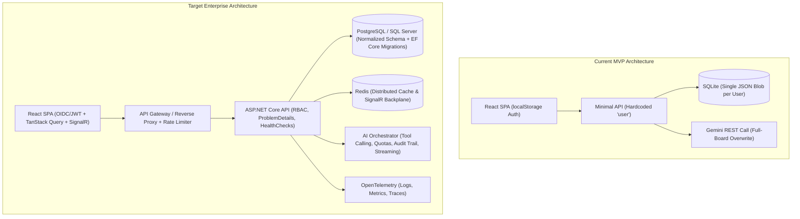

# Enterprise Readiness & Transformation Plan (`PLAN_ENTERPRISE.md`)

## Executive Summary

**Kanban Studio** is currently a functional Minimum Viable Product (MVP) built with an ASP.NET Core backend (`KanbanStudio.Api`), SQLite storage, Google Gemini AI integration, and a React + Vite + TypeScript frontend.

While the MVP demonstrates core board manipulation and AI-assisted project management, transitioning it to an **enterprise-grade application** requires addressing critical gaps in **security, data integrity, multi-tenancy, AI safety, observability, and operational scalability**.

This document outlines the required actions ordered strictly by priority (**P0 Critical → P1 High → P2 Medium → P3 Enhancement**), directly mapped to the current codebase.

---

## Architecture Evolution Overview

---

## Priority Matrix

| Priority | Phase | Focus Area | Primary Goal | Target Timeline |
| :--- | :--- | :--- | :--- | :--- |
| **P0** | **Phase 1** | **Security, AuthN/AuthZ & Hardening** | Eliminate critical security vulnerabilities & enforce real user isolation | Weeks 1–2 |
| **P1** | **Phase 2** | **Relational Data Model & Concurrency** | Replace monolithic JSON blob with normalized relational entities & migrations | Weeks 3–5 |
| **P2** | **Phase 3** | **AI Governance, Tool Calling & Reliability** | Prevent AI data loss via deterministic tool calling, streaming & token quotas | Weeks 6–7 |
| **P2** | **Phase 4** | **Multi-Tenancy, Collaboration & Domain Depth** | Add Workspaces, RBAC, rich card metadata, audit trails & real-time sync | Weeks 8–10 |
| **P3** | **Phase 5** | **Observability, Infrastructure & CI/CD** | Production telemetry, Kubernetes/cloud readiness, E2E testing & compliance | Weeks 11–12 |

---

## P0: Critical Security, Authentication & Authorization (Blockers)

These items represent immediate security vulnerabilities in the MVP that **must** be resolved before any external or multi-user deployment.

### 1. Implement Real Token-Based Authentication & SSO (OIDC / JWT)
* **Current State**:
  * `POST /api/auth/login` in `Program.cs` validates credentials and returns `{ username, status: "ok" }` with no token or cookie.
  * `App.tsx` stores `kanban_user` in `localStorage` and never sends credentials or headers on subsequent API calls (`frontend/src/lib/api.ts`).
  * `GET /api/kanban`, `PUT /api/kanban`, and `POST /api/chat` in `Program.cs` are completely unauthenticated and hardcode `"user"`.
* **Required Actions**:
  1. Integrate ASP.NET Core Authentication (`AddAuthentication().AddJwtBearer()` or `HttpOnly`, `Secure`, `SameSite=Strict` session cookies).
  2. Support Enterprise Single Sign-On (SSO) via OpenID Connect (OIDC) / SAML 2.0 (e.g., Microsoft Entra ID, Okta, Auth0, Keycloak).
  3. Issue short-lived access tokens + rotating refresh tokens, and extract the authenticated user/tenant identity from `ClaimsPrincipal` on every endpoint using `.RequireAuthorization()`.
  4. Update `frontend/src/lib/api.ts` to attach authorization credentials and handle `401 Unauthorized` responses by triggering token refresh or redirecting to login.

### 2. Upgrade Password Cryptography & Remove Hardcoded Seed Credentials
* **Current State**:
  * `DatabaseService.HashPassword` uses a single iteration of fast `SHA256` with an 8-byte salt.
  * `DatabaseService.InitDb` unconditionally seeds a default user (`user` / `password`) on startup.
* **Required Actions**:
  1. Replace `SHA256` with **Argon2id** (or ASP.NET Core Identity's `PasswordHasher<TUser>` using PBKDF2 with high iteration counts and 128-bit salts).
  2. Remove automatic seeding of `user` / `password` in production environments (`ASPNETCORE_ENVIRONMENT=Production`); restrict demo seeding to development/test environments or an explicit CLI bootstrap command.

### 3. Restrict CORS, Add Rate Limiting & Security Headers
* **Current State**:
  * `Program.cs` configures `AllowAnyOrigin().AllowAnyMethod().AllowAnyHeader()` for all environments.
  * No rate limiting on `/api/auth/login` (vulnerable to brute-force) or `/api/chat` (vulnerable to AI wallet exhaustion).
  * `Dockerfile` runs the runtime container as `root`.
* **Required Actions**:
  1. Restrict CORS origins via configuration (`AllowedOrigins` in `appsettings.json` / environment variables).
  2. Enable ASP.NET Core's built-in `UseRateLimiter()` middleware:
     * Strict IP/account rate limit + exponential backoff on `/api/auth/login`.
     * Per-user/tenant sliding window rate limit on `/api/chat`.
  3. Add security headers middleware (`Strict-Transport-Security`, `Content-Security-Policy`, `X-Content-Type-Options: nosniff`, `X-Frame-Options: DENY`).
  4. Switch the `Dockerfile` runtime stage to a non-root user (`USER $APP_UID`).

---

## P1: Data Architecture, Integrity & Concurrency

The current storage design cannot safely support concurrent requests, large boards, or schema evolution.

### 4. Normalize the Database Schema & Migrate to Enterprise RDBMS
* **Current State**:
  * `DatabaseService.cs` stores the entire board state in a single `board_json` text column inside SQLite (`boards` table with `user_id UNIQUE`).
  * `PUT /api/kanban` overwrites the entire JSON document on every card drag, edit, or creation.
* **Required Actions**:
  1. Introduce **Entity Framework Core (EF Core)** (or Dapper + FluentMigrator/DbUp) with versioned schema migrations.
  2. Support **PostgreSQL** (or Azure SQL / SQL Server) for production workloads while retaining SQLite/Testcontainers for local development and integration tests.
  3. Decompose `board_json` into normalized relational tables:
     * `Tenants` / `Organizations`
     * `Users` & `OrganizationMembers`
     * `Boards` (many boards per organization/project)
     * `Columns` (`Id`, `BoardId`, `Title`, `Position`, `WipLimit`)
     * `Cards` (`Id`, `ColumnId`, `Title`, `Details`, `Position`, `Priority`, `AssigneeId`, `DueDate`, `RowVersion`)
     * `ChatSessions` & `ChatMessages` (persisting AI conversation history per board/user)

### 5. Granular REST Endpoints & Optimistic Concurrency Control
* **Current State**:
  * If a user drags a card while another user (or the AI assistant) updates the board, the last `PUT /api/kanban` silently overwrites the other's changes (Lost Update problem).
* **Required Actions**:
  1. Replace full-board `PUT /api/kanban` with granular RESTful endpoints:
     * `POST /api/boards/{boardId}/cards`
     * `PATCH /api/boards/{boardId}/cards/{cardId}`
     * `POST /api/boards/{boardId}/cards/{cardId}/move` (using fractional indexing / LexoRank for $O(1)$ card reordering)
     * `DELETE /api/boards/{boardId}/cards/{cardId}`
     * `POST /api/boards/{boardId}/columns`, `PATCH /api/boards/{boardId}/columns/{columnId}`
  2. Implement **Optimistic Concurrency Control** using `ETag` / `If-Match` headers and database row versions (`xmin` in PostgreSQL or `rowversion` in SQL Server), returning `409 Conflict` when stale updates occur.
  3. Enforce request validation using **FluentValidation** or DataAnnotations (max lengths on titles/details, valid column IDs, payload size limits).

---

## P2: AI Governance, Tool Calling & Reliability

Currently, the AI integration asks the LLM to echo back the entire board JSON on every mutation, which is slow, token-expensive, and prone to catastrophic data loss on larger boards.

### 6. Refactor AI Mutations from Full-Board Regeneration to Function/Tool Calling
* **Current State**:
  * `GeminiChatService.cs` serializes the entire board into the prompt and defines a `responseSchema` requiring the LLM to return the complete `columns` and `cards` array whenever any change is made, then overwrites the database with `db.UpdateBoardData("user", response.Board)`.
  * If the model omits existing cards or hallucinates IDs, board data is permanently corrupted or lost.
* **Required Actions**:
  1. Adopt **Gemini Function Calling (Tools)** for deterministic, atomic operations:
     * `create_card(columnId, title, details, priority, assignee)`
     * `update_card(cardId, title, details, priority)`
     * `move_card(cardId, targetColumnId, position)`
     * `delete_card(cardId)` (require explicit user confirmation or soft-delete/archive)
     * `rename_column(columnId, newTitle)`
  2. Execute tool calls inside a database transaction with domain validation so the LLM can never accidentally wipe unrelated cards.
  3. Move the Gemini API key from the URL query string (`?key={apiKey}`) to the `x-goog-api-key` HTTP request header so it is never exposed in URL logs or telemetry traces.

### 7. AI Resilience, Streaming, Guardrails & Cost Control
* **Current State**:
  * `GeminiChatService` only retries once on HTTP `503` and throws raw exceptions (`500 Internal Server Error` with `ex.Message` leaked to the client).
  * Chat history is sent unbounded from the client and lost on browser refresh.
* **Required Actions**:
  1. Configure `Microsoft.Extensions.Http.Resilience` (Polly) on the `GeminiChatService` `HttpClient` with exponential backoff, jitter, timeout policies, and circuit breakers for `429 Too Many Requests` and `5xx` responses.
  2. Implement **Server-Sent Events (SSE)** (`POST /api/boards/{boardId}/chat/stream`) for real-time token streaming to the UI.
  3. Add prompt-injection defenses (delimit untrusted card content, sanitize outputs) and persist chat history and token usage (`PromptTokenCount`, `CandidatesTokenCount`) per tenant for cost accounting and quota enforcement.

---

## P2: Multi-Tenancy, Collaboration & Enterprise Domain Features

### 8. Multi-Tenant Workspaces, RBAC & Audit Logging
* **Current State**:
  * Strictly one board per user; no concept of teams, shared boards, permissions, or audit history.
* **Required Actions**:
  1. Introduce **Workspaces / Organizations** and **Multi-Board Management**.
  2. Implement **Role-Based Access Control (RBAC)**:
     * `WorkspaceAdmin`: Manage billing, members, AI quotas, and security policies.
     * `BoardAdmin`: Configure columns, WIP limits, and board settings.
     * `Member` / `Editor`: Create, move, and edit cards; use AI assistant.
     * `Viewer` / `Guest`: Read-only access to boards.
  3. Record an immutable **Audit Trail / Activity Log** (`AuditLogs` table) capturing who (User or AI Agent) created, updated, moved, or deleted any entity, with before/after diffs and undo/restore (soft-delete) support.

### 9. Real-Time Collaboration & Rich Card Capabilities
* **Required Actions**:
  1. Integrate **ASP.NET Core SignalR** (backed by Redis in multi-instance deployments) to broadcast board changes (`CardMoved`, `CardUpdated`, `CardCreated`, `UserPresence`) in real time to all connected team members.
  2. Expand the `Card` domain model to meet enterprise project management needs:
     * Assignees, Reporters, Due Dates, and Story Points / Estimates.
     * Custom Labels/Tags, Priority levels (`Low`, `Medium`, `High`, `Critical`), and Column WIP Limits.
     * Card Comments, Subtasks/Checklists, and File Attachments (stored in S3 / Azure Blob Storage with virus scanning).
     * Search, filtering (by assignee, tag, priority, text), and keyboard shortcuts.

---

## P3: Observability, Operations, Frontend Resilience & CI/CD

### 10. Production Observability, Error Handling & Health Probes
* **Current State**:
  * `/api/health` returns a static `{ status = "ok" }` without checking if SQLite or Gemini is reachable.
  * Unhandled errors return raw `ex.Message` strings.
* **Required Actions**:
  1. Adopt **OpenTelemetry** for distributed tracing, metrics (request latency, error rates, AI token consumption, DB query duration), and structured JSON logging (Serilog).
  2. Standardize all API errors on **RFC 9457 `ProblemDetails`** (`builder.Services.AddProblemDetails()`, `app.UseExceptionHandler()`) to prevent leaking internal stack traces or sensitive error details.
  3. Replace `/api/health` with ASP.NET Core Health Checks:
     * `/health/live` (Liveness probe — process is up).
     * `/health/ready` (Readiness probe — verifies database connectivity and migrations status).

### 11. Frontend Enterprise Polish & Accessibility
* **Current State**:
  * Direct `fetch` calls in `KanbanBoard.tsx` without caching, retry logic, error boundaries, or accessibility compliance.
* **Required Actions**:
  1. Adopt **TanStack Query (React Query)** for server-state caching, background revalidation, and optimistic drag-and-drop updates with automatic rollback on failure.
  2. Add React **Error Boundaries**, toast notifications for transient errors, and offline/reconnection indicators.
  3. Ensure **WCAG 2.1 AA Accessibility** (full keyboard navigation for Kanban drag-and-drop via `@dnd-kit`, ARIA live announcements, high-contrast support) and internationalization (`i18next`).

### 12. Automated CI/CD Pipeline, Quality Gates & Deployment
* **Required Actions**:
  1. Create automated CI/CD workflows (GitHub Actions / Azure DevOps):
     * Build & unit test backend (`dotnet test` with code coverage gates) and frontend (`vitest`, `tsc --noEmit`, `eslint`).
     * End-to-End (E2E) browser test suite using **Playwright** covering login, card drag-and-drop, and AI chat workflows.
     * Security scanning: Dependabot/Renovate, CodeQL SAST, `dotnet list package --vulnerable`, `npm audit`, and Trivy container image scanning.
  2. Provide production infrastructure templates (Helm charts / Terraform / Bicep) with secrets managed via Azure Key Vault / AWS Secrets Manager / HashiCorp Vault rather than `.env` files.

---

## Step-by-Step Execution Roadmap

1. **Milestone 1 — Security & Identity Foundation (P0)**
   * Add JWT/OIDC authentication, secure password hashing (Argon2id/PBKDF2), endpoint authorization, CORS lockdown, rate limiting, and non-root Docker user.
2. **Milestone 2 — Relational Data & Granular API (P1)**
   * Introduce EF Core + PostgreSQL, normalize `Users`, `Boards`, `Columns`, `Cards`, `ChatMessages`, add migrations, and expose granular CRUD endpoints with optimistic concurrency (`ETag`).
3. **Milestone 3 — Safe & Scalable AI Assistant (P2)**
   * Convert `GeminiChatService` from full-board JSON replacement to Gemini Function Calling, move API key to headers, add Polly resilience, persist chat history, and support SSE streaming.
4. **Milestone 4 — Multi-Tenant Collaboration (P2)**
   * Add Workspaces, multi-board routing, RBAC permissions, audit/activity logs, soft-delete/archive, rich card fields, and real-time SignalR board sync.
5. **Milestone 5 — Enterprise Operations & Compliance (P3)**
   * Integrate OpenTelemetry, RFC 9457 `ProblemDetails`, readiness/liveness health probes, TanStack Query frontend refactor, Playwright E2E tests, and CI/CD security gates.

