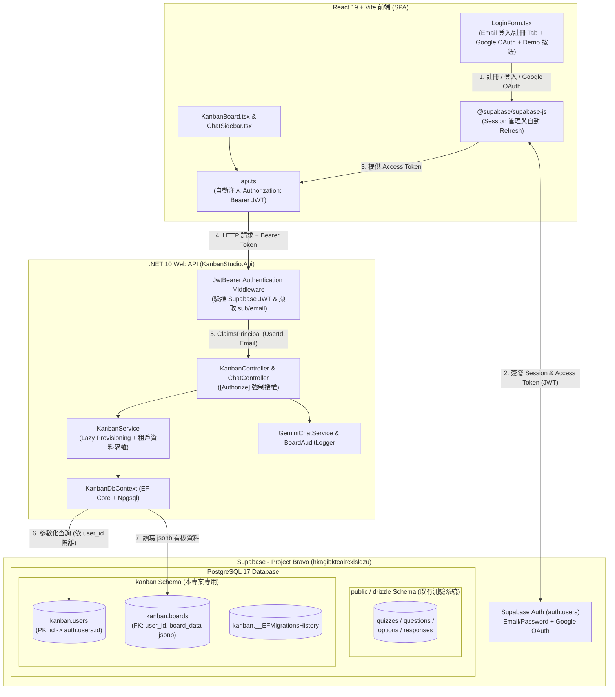

# Kanban Studio 多租戶架構與 Supabase 升級計劃 (`PLAN_MULTI_TENANTS.md`)

## 1. 執行摘要 (Executive Summary)

本計劃旨在將 **Kanban Studio** 由原本「單一預設帳號 (`user`/`password`) + 本地 SQLite (`data/pm.db`)」的單機架構，全面升級為基於 **Supabase (`Project Bravo`, Project ID: `hkagibktealrcxlslqzu`)** 的**個人多租戶 (Per-User Multi-Tenancy)** 雲端原生架構。

升級後系統將徹底移除 SQLite，改用 Supabase PostgreSQL 17 儲存使用者資料與看板資料，並透過 Supabase Auth 支援 **Email + 密碼註冊／登入** 以及 **Google OAuth 第三方登入**。每位註冊使用者皆擁有完全獨立、依 `user_id` (`UUID`) 嚴格隔離的個人看板與 AI 對話操作環境。

---

## 2. 核心架構決策總覽 (Architectural Decisions)

| 決策維度 | 選定方案 | 設計理由與效益 |
| :--- | :--- | :--- |
| **多租戶隔離層級** | **個人多租戶 (Per-User Isolation)** | 每位註冊使用者擁有獨立看板空間，所有讀寫與 AI 操作皆依 `user_id` (`UUID`) 嚴格隔離，不互相干擾。 |
| **目標 Supabase 專案** | **Project Bravo (`hkagibktealrcxlslqzu`)** | 位於 `ap-northeast-2` (PostgreSQL 17.6)，API URL 為 `https://hkagibktealrcxlslqzu.supabase.co`。 |
| **資料庫 Schema 隔離** | **獨立 `kanban` Schema (`kanban.*`)** | `Project Bravo` 的 `public` schema 已有測驗系統資料表 (`quizzes`, `questions`, `options`, `responses`) 與 Drizzle 紀錄。建立獨立 `kanban` schema 可確保兩個專案完全隔離、互不衝突。 |
| **看板儲存格式** | **PostgreSQL `jsonb` (`kanban.boards.board_data`)** | 完美相容現有 `BoardData` (`columns` + `cards`) API 契約、`GeminiChatService` 結構化輸出與 `BoardAuditLogger` 差異比對，遷移風險最低且具備 `jsonb` 高效讀寫能力。 |
| **使用者與看板初始化** | **`kanban.users` + `kanban.boards` 搭配 Lazy Provisioning** | 當已驗證使用者首次存取看板時，由 .NET 後端自動從 JWT Claims 同步建立 `kanban.users` 紀錄與預設範例看板 (`GetInitialBoardData()`)，同時相容 `Project Bravo` 現有的 4 位使用者與未來新註冊者。 |
| **認證與前後端分工** | **前端 `@supabase/supabase-js` + 後端 JWT Bearer 驗證** | 前端直接透過 Supabase Auth 處理信箱註冊/登入、OAuth 跳轉與 Token 自動刷新；呼叫 `.NET API` (`/api/kanban`、`/api/chat`) 時帶入 `Authorization: Bearer <token>`，由後端驗證 JWT 並執行資料庫存取。 |
| **後端 ORM 與遷移** | **EF Core (`Npgsql.EntityFrameworkCore.PostgreSQL`) + 混合式 Migration** | 使用 `KanbanDbContext` 搭配強型別 Entity；將 `__EFMigrationsHistory` 隔離於 `kanban` schema，並在 EF Migration 內嵌 SQL 設定 `auth.users(id)` 外鍵與 Supabase RLS 安全性策略。 |
| **前端認證 UI 設計** | **單一卡片「登入 / 註冊」Tab 切換 + Google 登入 + Demo 測試帳號按鈕** | 移除舊後端 `AuthController`，支援註冊後收驗證信提示狀態，並保留一組測試信箱帳號的 Demo 快速填入按鈕以便本地展示。 |
| **自動化測試策略** | **EF Core InMemory + `TestAuthHandler`** | 徹底移除 SQLite 測試依賴，支援離線快速測試，並新增「未授權 `401` 攔截」與「User A / User B 跨租戶資料隔離」整合測試。 |

---

## 3. 系統架構與資料流圖 (Architecture & Data Flow)



---

## 4. Supabase (`Project Bravo`) 資料庫與安全性設計

### 4.1 Schema 與資料表結構 (`kanban` Schema)

在 `Project Bravo` (`hkagibktealrcxlslqzu`) 中建立獨立的 `kanban` schema，包含以下兩張核心表與 EF Core 遷移紀錄表：

#### 1. `kanban.users`（應用程式使用者設定檔表）
| 欄位名稱 | 資料型別 | 約束條件 | 說明 |
| :--- | :--- | :--- | :--- |
| `id` | `uuid` | `PRIMARY KEY`, `REFERENCES auth.users(id) ON DELETE CASCADE` | 對應 Supabase Auth 的 `sub` (`auth.uid()`) |
| `email` | `text` | `NOT NULL` | 使用者電子郵件 |
| `display_name` | `text` | `NULL` | 顯示名稱（取自 Google `full_name`/`name` 或 Email 前綴） |
| `avatar_url` | `text` | `NULL` | 頭像網址（取自 Google OAuth `avatar_url`） |
| `created_at` | `timestamptz` | `NOT NULL DEFAULT now()` | 建立時間 (UTC) |
| `updated_at` | `timestamptz` | `NOT NULL DEFAULT now()` | 最後更新時間 (UTC) |

#### 2. `kanban.boards`（租戶個人看板資料表）
| 欄位名稱 | 資料型別 | 約束條件 | 說明 |
| :--- | :--- | :--- | :--- |
| `id` | `uuid` | `PRIMARY KEY DEFAULT gen_random_uuid()` | 看板唯一識別碼 |
| `user_id` | `uuid` | `NOT NULL UNIQUE`, `REFERENCES kanban.users(id) ON DELETE CASCADE` | 看板擁有者 ID（每位使用者獨立一組看板） |
| `board_data` | `jsonb` | `NOT NULL` | 序列化之 `BoardData` (`columns` 陣列與 `cards` 字典) |
| `created_at` | `timestamptz` | `NOT NULL DEFAULT now()` | 建立時間 (UTC) |
| `updated_at` | `timestamptz` | `NOT NULL DEFAULT now()` | 最後更新時間 (UTC) |

### 4.2 Row-Level Security (RLS) 與跨 Schema 外鍵 SQL 設計

遵循 Supabase Postgres 安全最佳實踐，在 EF Core Migration 的 `Up(MigrationBuilder migrationBuilder)` 中內嵌以下 SQL：

```sql
-- 1. 確保 kanban schema 存在
CREATE SCHEMA IF NOT EXISTS kanban;

-- 2. 將 kanban.users.id 外鍵連結至 Supabase 的 auth.users(id)，當帳號刪除時自動級聯清理
ALTER TABLE kanban.users
    ADD CONSTRAINT fk_kanban_users_auth_users
    FOREIGN KEY (id) REFERENCES auth.users(id) ON DELETE CASCADE;

-- 3. 啟用 Row-Level Security (縱深防禦 Defense-in-Depth)
ALTER TABLE kanban.users ENABLE ROW LEVEL SECURITY;
ALTER TABLE kanban.boards ENABLE ROW LEVEL SECURITY;

-- 4. kanban.users 的 RLS Policies (使用 (select auth.uid()) 確保查詢計畫快取最佳化)
CREATE POLICY "Users can view own profile"
    ON kanban.users FOR SELECT
    TO authenticated
    USING ( (select auth.uid()) = id );

CREATE POLICY "Users can insert own profile"
    ON kanban.users FOR INSERT
    TO authenticated
    WITH CHECK ( (select auth.uid()) = id );

CREATE POLICY "Users can update own profile"
    ON kanban.users FOR UPDATE
    TO authenticated
    USING ( (select auth.uid()) = id )
    WITH CHECK ( (select auth.uid()) = id );

-- 5. kanban.boards 的 RLS Policies
CREATE POLICY "Users can view own board"
    ON kanban.boards FOR SELECT
    TO authenticated
    USING ( (select auth.uid()) = user_id );

CREATE POLICY "Users can insert own board"
    ON kanban.boards FOR INSERT
    TO authenticated
    WITH CHECK ( (select auth.uid()) = user_id );

CREATE POLICY "Users can update own board"
    ON kanban.boards FOR UPDATE
    TO authenticated
    USING ( (select auth.uid()) = user_id )
    WITH CHECK ( (select auth.uid()) = user_id );

CREATE POLICY "Users can delete own board"
    ON kanban.boards FOR DELETE
    TO authenticated
    USING ( (select auth.uid()) = user_id );
```

### 4.3 Supabase 後台設定檢核項 (Auth & Google OAuth)

1. **Email Auth 設定**：
   * 確認 `Project Bravo` 已啟用 Email Provider。
   * 由於 `Project Bravo` 目前啟用了 Email Confirmation（信箱驗證），前端註冊表單會在 `signUp()` 回傳 `session === null` 時顯示「請前往信箱點擊驗證信連結以完成啟用」的友善提示。
   * 建立（或指定）一組已驗證的測試帳號（例如 `demo@kanbanstudio.dev` / `DemoPassword123!`）供前端 Demo 快速填入按鈕使用。
2. **Google OAuth Provider 設定**：
   * 於 Supabase Dashboard → **Authentication → Providers → Google** 啟用 Google 登入，填入 Google Cloud Console OAuth 2.0 Client ID 與 Client Secret。
   * 於 **Authentication → URL Configuration → Redirect URLs** 加入本地開發與正式環境網址：
     * `http://localhost:5173/**` (Vite 開發伺服器)
     * `http://localhost:8000/**` (Docker / .NET 託管環境)

---

## 5. 後端 (.NET 10 Web API) 升級實作規格

### 5.1 NuGet 套件調整 ([`KanbanStudio.Api.csproj`](file:///D:/projects/kanban-studio-dotnet/backend/src/KanbanStudio.Api/KanbanStudio.Api.csproj))

* **移除**：
  * `Microsoft.Data.Sqlite`
* **新增**：
  * `Npgsql.EntityFrameworkCore.PostgreSQL` (v10.0.x)
  * `Microsoft.EntityFrameworkCore.Design` (v10.0.x)
  * `Microsoft.AspNetCore.Authentication.JwtBearer` (v10.0.x)

### 5.2 Entity 與 `KanbanDbContext` 設計

於 `backend/src/KanbanStudio.Api/Data/` 新增：

1. **`Entities/KanbanUser.cs`**：
   * 對應 `kanban.users` 資料表（屬性：`Id (Guid)`, `Email`, `DisplayName`, `AvatarUrl`, `CreatedAt`, `UpdatedAt`, 導覽屬性 `Board`）。
2. **`Entities/KanbanBoard.cs`**：
   * 對應 `kanban.boards` 資料表（屬性：`Id (Guid)`, `UserId (Guid)`, `BoardData (BoardData)` 透過 `.HasColumnType("jsonb")` 映射, `CreatedAt`, `UpdatedAt`）。
3. **`KanbanDbContext.cs`**：
   * 在 `OnModelCreating` 設定 `modelBuilder.HasDefaultSchema("kanban");`。
   * 設定 `KanbanUser` (`users`) 與 `KanbanBoard` (`boards`) 的一對一關聯、`user_id` 唯一索引 (`HasIndex(b => b.UserId).IsUnique()`) 以及 `jsonb` 序列化轉換，確保與既有的 `BoardData` 模型完全相容。
   * 在 `Program.cs` 註冊 `DbContext` 時，指定 Migration History 表隔離於 `kanban` schema：
     ```csharp
     npgsqlOptions.MigrationsHistoryTable("__EFMigrationsHistory", "kanban");
     ```

### 5.3 資料存取服務與 Lazy Provisioning (`IKanbanRepository` / `KanbanRepository.cs`)

取代原有的 [`DatabaseService.cs`](file:///D:/projects/kanban-studio-dotnet/backend/src/KanbanStudio.Api/Data/DatabaseService.cs)（並彻底刪除 `DatabaseService.cs` 及 `data/pm.db`）：

* 定義 `UserContext(Guid UserId, string Email, string? DisplayName, string? AvatarUrl)`。
* **`GetOrCreateBoardAsync(UserContext user, CancellationToken ct)`**：
  1. 以 `user.UserId` 查詢 `kanban.boards` (AsNoTracking)。
  2. 若已存在，直接回傳 `BoardData`。
  3. 若不存在（代表該使用者為新註冊帳號，或是 `Project Bravo` 既有的 4 位使用者首次進入 Kanban Studio）：
     * 檢查 `kanban.users` 是否存在該 `UserId`，若無則建立 `KanbanUser`，若有則更新 `Email`/`DisplayName`/`AvatarUrl`。
     * 呼叫 `DefaultBoardSeed.GetInitialBoardData()` 產生預設 5 個欄位（Backlog, Discovery, In Progress, Review, Done）與 8 張範例卡片，寫入 `kanban.boards` 並 `SaveChangesAsync(ct)`。
     * 處理並發首次請求的 Unique Constraint 例外保護（若同時發出兩個請求，捕獲重複鍵並重新讀取）。
* **`UpdateBoardAsync(UserContext user, BoardData boardData, CancellationToken ct)`**：
  * 僅針對 `b.UserId == user.UserId` 的看板更新 `BoardData` 與 `UpdatedAt = DateTime.UtcNow`。

### 5.4 Supabase JWT Bearer 驗證整合 ([`Program.cs`](file:///D:/projects/kanban-studio-dotnet/backend/src/KanbanStudio.Api/Program.cs))

在 `Program.cs` 中設定 ASP.NET Core 驗證與授權中介軟體：

* 支援 Supabase JWKS 自動探索（`Authority = "https://hkagibktealrcxlslqzu.supabase.co/auth/v1"`）與非對稱 (`ES256`/`RS256`) 或對稱 (`HS256` `SUPABASE_JWT_SECRET`) 簽章驗證：
  * `ValidateIssuer = true` (`ValidIssuer = "https://hkagibktealrcxlslqzu.supabase.co/auth/v1"`)
  * `ValidateAudience = true` (`ValidAudience = "authenticated"`)
  * `ValidateLifetime = true`
* 新增擴充方法 `ClaimsPrincipalExtensions.GetUserContext(this ClaimsPrincipal principal)`：
  * 從 `ClaimTypes.NameIdentifier` 或 `"sub"` 解析 `Guid userId`。
  * 從 `ClaimTypes.Email` 或 `"email"` 解析信箱。
  * 從 `"user_metadata"` JSON Claim 提取 `full_name` / `name` 與 `avatar_url`。

### 5.5 控制器改造與舊端點清理

1. **刪除 [`AuthController.cs`](file:///D:/projects/kanban-studio-dotnet/backend/src/KanbanStudio.Api/Controllers/AuthController.cs) 與 [`AuthModels.cs`](file:///D:/projects/kanban-studio-dotnet/backend/src/KanbanStudio.Api/Models/AuthModels.cs)**：
   * 認證改由前端透過 Supabase Auth 處理，不再保留明文帳密比對與 SHA256 雜湊邏輯。
2. **升級 [`KanbanController.cs`](file:///D:/projects/kanban-studio-dotnet/backend/src/KanbanStudio.Api/Controllers/KanbanController.cs)**：
   * 加上 `[Authorize]` 屬性。
   * `GET /api/kanban`：透過 `User.GetUserContext()` 取得當前租戶資訊，呼叫 `GetOrCreateBoardAsync` 回傳該租戶專屬看板。
   * `PUT /api/kanban`：透過 `User.GetUserContext()` 取得當前租戶資訊，更新該租戶看板並觸發 `_auditLogger.LogBoardChanges(oldBoard, payload, "UserUpdate", user.UserId)`。
3. **升級 [`ChatController.cs`](file:///D:/projects/kanban-studio-dotnet/backend/src/KanbanStudio.Api/Controllers/ChatController.cs)**：
   * 加上 `[Authorize]` 屬性。
   * `POST /api/chat`：讀取當前租戶 `user.UserId` 的看板傳入 `_chatService.ChatAsync(...)`，若 AI 回傳修改後的看板，僅更新該租戶的 `kanban.boards` 紀錄。

---

## 6. 前端 (React + Vite + TypeScript) 升級實作規格

### 6.1 新增套件與 Supabase Client 初始化

1. 於 [`frontend/package.json`](file:///D:/projects/kanban-studio-dotnet/frontend/package.json) 安裝 `@supabase/supabase-js`（固定確切版本號並提交 `package-lock.json`）。
2. 新增 `frontend/src/lib/supabase.ts`：
   ```typescript
   import { createClient } from "@supabase/supabase-js";

   const supabaseUrl = import.meta.env.VITE_SUPABASE_URL || "https://hkagibktealrcxlslqzu.supabase.co";
   const supabaseAnonKey = import.meta.env.VITE_SUPABASE_ANON_KEY || "";

   export const supabase = createClient(supabaseUrl, supabaseAnonKey);
   ```

### 6.2 認證狀態管理 ([`App.tsx`](file:///D:/projects/kanban-studio-dotnet/frontend/src/App.tsx))

* 移除原有的 `localStorage.getItem("kanban_user")` 假登入機制。
* 改用 `supabase.auth.getSession()` 初始化檢查目前登入狀態，並訂閱 `supabase.auth.onAuthStateChange((_event, session) => ...)`：
  * 自動處理 Google OAuth 重導向回頁面後的 URL Hash / PKCE Code 交換。
  * 當 `session?.user` 存在時，將使用者顯示名稱（優先順序：`user_metadata.full_name` → `user_metadata.name` → `email`）與 `onLogout` (`await supabase.auth.signOut()`) 傳入 `<KanbanBoard />`。
  * 在首次檢查 Session 期間顯示載入狀態，避免畫面閃爍。

### 6.3 認證介面改版 ([`LoginForm.tsx`](file:///D:/projects/kanban-studio-dotnet/frontend/src/components/LoginForm.tsx))

保留現有現代化視覺風格，升級為完整的多元認證卡片：

1. **「登入 (Sign In)」與「註冊 (Sign Up)」Tab 切換**：
   * 將原本的 `Username` 欄位改為 `Email` (`type="email"`, `autoComplete="email"`)。
   * 註冊模式下可選填顯示名稱（或驗證密碼長度至少 6 碼）。
   * 登入模式呼叫 `supabase.auth.signInWithPassword({ email, password })`。
   * 註冊模式呼叫 `supabase.auth.signUp({ email, password })`：
     * 若回傳 `data.user && !data.session`（代表需信箱驗證），顯示綠色成功提示框：「註冊成功！請前往您的信箱點擊驗證連結後再行登入。」
2. **Google OAuth 登入按鈕**：
   * 新增帶有 Google 官方圖示的 **「Continue with Google (使用 Google 帳號繼續)」** 按鈕。
   * 點擊時呼叫：
     ```typescript
     await supabase.auth.signInWithOAuth({
       provider: "google",
       options: { redirectTo: window.location.origin },
     });
     ```
3. **保留 Demo 快速填入按鈕**：
   * 將原本填入 `user` / `password` 的按鈕，改為填入環境變數或預設的展示用測試信箱與密碼（例如 `VITE_DEMO_EMAIL` / `VITE_DEMO_PASSWORD`，預設顯示測試信箱帳號），方便本地一鍵體驗。

### 6.4 API 請求自動附帶 Bearer Token ([`frontend/src/lib/api.ts`](file:///D:/projects/kanban-studio-dotnet/frontend/src/lib/api.ts))

* 移除 `loginUser` 函式。
* 新增內部輔助函式 `getAuthHeaders()`：
  * 透過 `const { data: { session } } = await supabase.auth.getSession()` 取得 `session?.access_token`。
  * 自動在 `fetchKanbanBoard()`、`updateKanbanBoard()`、`sendChatMessage()` 的 HTTP Headers 加入 `Authorization: Bearer ${session.access_token}`。
  * 若後端回傳 `401 Unauthorized`，自動呼叫 `supabase.auth.signOut()` 讓畫面回到登入頁。

---

## 7. 環境變數與容器化部署設定

### 7.1 `.env.example` 與環境變數規範

更新 [`.env.example`](file:///D:/projects/kanban-studio-dotnet/.env.example)，移除 `DATABASE_PATH`，新增 Supabase 相關設定：

```dotenv
# Google Gemini API Key for AI Chat sidebar
GEMINI_API_KEY=your_gemini_api_key_here
# GEMINI_MODEL=gemini-3.5-flash-lite

# Supabase Project Bravo (hkagibktealrcxlslqzu) Configuration
SUPABASE_URL=https://hkagibktealrcxlslqzu.supabase.co
ConnectionStrings__Supabase=Host=aws-0-ap-northeast-2.pooler.supabase.com;Port=6543;Database=postgres;Username=postgres.hkagibktealrcxlslqzu;Password=your_db_password_here;SSL Mode=Require;Trust Server Certificate=true

# Frontend Vite Build / Runtime Variables
VITE_SUPABASE_URL=https://hkagibktealrcxlslqzu.supabase.co
VITE_SUPABASE_ANON_KEY=your_supabase_anon_or_publishable_key_here
VITE_DEMO_EMAIL=demo@kanbanstudio.dev
VITE_DEMO_PASSWORD=DemoPassword123!
```

> **連線池注意事項**：在雲端或容器環境連線至 Supabase PostgreSQL 時，若使用 Transaction Pooler (Port `6543`)，會在 Npgsql 連線字串或 `UseNpgsql` 設定 `Max Auto Prepare=0` / `No Reset On Close=true` 以確保與 Supavisor PgBouncer 完全相容；執行 `dotnet ef database update` 時則可使用 Session Pooler (Port `5432`)。

### 7.2 `Dockerfile` 與 `docker-compose.yml` 清理

* **[`docker-compose.yml`](file:///D:/projects/kanban-studio-dotnet/docker-compose.yml)**：
  * 移除 `DATABASE_PATH=/app/data/pm.db` 環境變數。
  * 移除 `./data:/app/data` 本地磁碟掛載 (volumes)。
  * 改為傳遞 `ConnectionStrings__Supabase`、`SUPABASE_URL` 等環境變數。
* **[`Dockerfile`](file:///D:/projects/kanban-studio-dotnet/Dockerfile)**：
  * 於前端建置階段 (`node` stage) 宣告 `ARG VITE_SUPABASE_URL`、`ARG VITE_SUPABASE_ANON_KEY`、`ARG VITE_DEMO_EMAIL`、`ARG VITE_DEMO_PASSWORD` 供 Vite 打包注入。
  * 移除建立 `/app/data` SQLite 目錄的步驟。

---

## 8. 自動化測試升級策略 (Testing Strategy)

### 8.1 後端測試 ([`KanbanStudio.Tests`](file:///D:/projects/kanban-studio-dotnet/backend/tests/KanbanStudio.Tests/KanbanStudio.Tests.csproj))

1. **測試基礎建設 (`CustomWebApplicationFactory.cs`)**：
   * 新增套件 `Microsoft.EntityFrameworkCore.InMemory`。
   * 移除 `DatabaseService` 與暫存 `.db` 檔案邏輯，改為替換 `DbContextOptions<KanbanDbContext>` 為獨立名稱的 `UseInMemoryDatabase($"KanbanTestDb_{Guid.NewGuid()}")`。
   * 註冊測試專用 `TestAuthHandler` (`AuthenticationHandler<AuthenticationSchemeOptions>`)：
     * 若請求未帶 `Authorization` 或 `X-Test-User-Id` Header，模擬未驗證狀態（回傳 `401 Unauthorized`）。
     * 支援在測試中透過 Header 指定不同測試租戶（例如 `User A: 11111111-1111-1111-1111-111111111111`、`User B: 22222222-2222-2222-2222-222222222222`），以驗證多租戶隔離。
2. **測試案例更新與擴充**：
   * **`AuthTests.cs`（重構為授權與多租戶隔離測試）**：
     * `UnauthenticatedRequest_Returns401`：驗證未帶 Token 呼叫 `GET /api/kanban`、`PUT /api/kanban`、`POST /api/chat` 皆回傳 `401`。
     * `MultiTenantIsolation_UserACannotSeeOrOverwriteUserBBoard`：驗證 User A 修改自己的看板或透過 AI Chat 新增卡片後，User B 讀取 `GET /api/kanban` 仍維持 User B 自己的獨立看板資料。
   * **`KanbanApiTests.cs` & `ChatApiTests.cs`**：
     * 更新為使用已授權的測試 HttpClient，驗證首次存取自動建立 `KanbanUser` 與預設看板 (Lazy Provisioning)、看板更新持久化與 AI 對話更新。

### 8.2 前端測試 (`frontend/src/**/*.test.tsx`)

1. **Mock `@supabase/supabase-js`**：
   * 在測試中模擬 `supabase.auth.getSession`、`onAuthStateChange`、`signInWithPassword`、`signUp`、`signInWithOAuth` 與 `signOut`。
2. **`LoginForm.test.tsx`**：
   * 驗證「登入 / 註冊」Tab 切換與表單提交。
   * 驗證點擊「使用 Google 帳號繼續」會觸發 `signInWithOAuth({ provider: 'google' })`。
   * 驗證點擊 Demo 按鈕會自動填入展示用測試信箱與密碼。
   * 驗證註冊需要信箱驗證時的提示訊息顯示。
3. **`api.test.ts`**：
   * 驗證 `fetchKanbanBoard`、`updateKanbanBoard`、`sendChatMessage` 皆會自動帶上 `Authorization: Bearer <token>` Header。

---

## 9. 分階段執行路線圖 (Step-by-Step Execution Plan)

### Phase 1：資料庫 Schema 建立與後端 EF Core 遷移
1. 修改 `KanbanStudio.Api.csproj`，移除 `Microsoft.Data.Sqlite`，安裝 `Npgsql.EntityFrameworkCore.PostgreSQL`、`Microsoft.EntityFrameworkCore.Design`、`Microsoft.AspNetCore.Authentication.JwtBearer`。
2. 建立 `KanbanUser`、`KanbanBoard` 實體與 `KanbanDbContext`（指定 `kanban` schema）。
3. 產生初始 EF Core Migration (`InitialKanbanSchema`)，內嵌 `auth.users(id)` 外鍵與 Supabase RLS Policies SQL，並套用至 Supabase `Project Bravo` (`hkagibktealrcxlslqzu`)，確認 `kanban.users` 與 `kanban.boards` 及 RLS 建立完成且不影響 `public` schema。

### Phase 2：後端 JWT 驗證、多租戶服務與清理 SQLite
1. 實作 `IKanbanRepository` / `KanbanRepository`（含 Lazy Provisioning 首次存取自動初始化使用者與預設看板）。
2. 於 `Program.cs` 設定 Supabase JWT Bearer 驗證與 `ClaimsPrincipal` 租戶解析。
3. 更新 `KanbanController` 與 `ChatController` 套用 `[Authorize]` 並改以當前 `UserId` 讀寫資料。
4. 刪除 `AuthController.cs`、`AuthModels.cs`、`DatabaseService.cs` 及 `data/pm.db`。

### Phase 3：前端 Supabase Auth 整合與 UI 改版
1. 安裝 `@supabase/supabase-js` 並建立 `src/lib/supabase.ts`。
2. 改寫 `LoginForm.tsx`（支援 Email 登入/註冊 Tab、信箱驗證提示、Google OAuth 按鈕、Demo 快速填入按鈕）。
3. 更新 `App.tsx` 使用 Supabase Session 狀態管理，並更新 `src/lib/api.ts` 自動附加 Bearer Token。

### Phase 4：環境設定、容器化更新與自動化測試驗收
1. 更新 `.env.example`、`appsettings.json`、`Dockerfile`、`docker-compose.yml` 與啟動腳本 (`scripts/start.*`)。
2. 升級 `KanbanStudio.Tests`（改用 EF Core InMemory + `TestAuthHandler`）並執行 `dotnet test`，確保所有後端測試與多租戶隔離測試全數通過。
3. 升級前端單元測試並執行 `npm test` 與 `npm run build`，確保型別檢查、測試與打包皆零錯誤。
